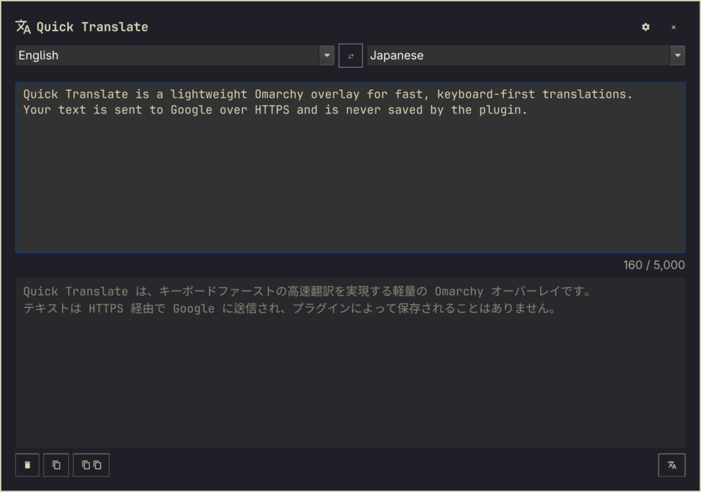
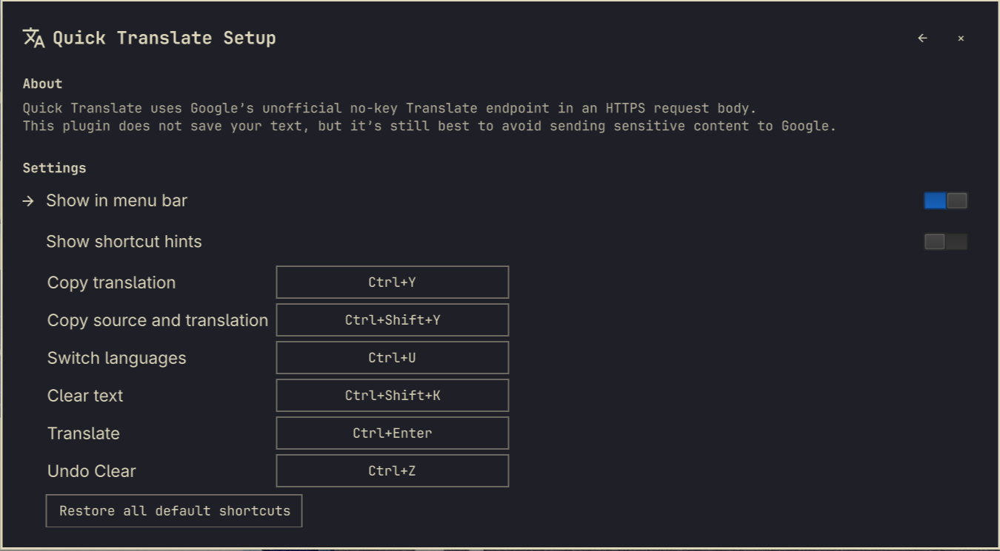

# Quick Translate for Omarchy

A fast, keyboard-first translation overlay for [Omarchy](https://omarchy.org/).
It starts with Google and English → Japanese, remembers your selected
translator and language pair, and keeps text only for the current Omarchy Shell
session.

## Install

Install from a public Git repository:

    omarchy plugin add https://github.com/seshna/quick-translate.git --enable

The overlay can then be opened from a terminal:

    omarchy-shell shell toggle shaun.quick-translate '{}'

It also adds a translate icon to the right side of the Omarchy bar. Open the
overlay and select the gear icon to hide that bar button or change shortcuts.

To add the suggested Super+Shift+T binding, add this to
~/.config/hypr/bindings.lua and reload Hyprland:

    o.bind("SUPER + SHIFT + T", "Quick Translate",
      "omarchy-shell shell toggle shaun.quick-translate '{}'")

If you already use that shortcut, choose another binding or unbind the existing
one first.

## Remove

Disable and remove the plugin with:

    omarchy plugin remove shaun.quick-translate

## Features

- Google (default), Apertium, Bing, Reverso, Ollama Local, OpenAI, and Claude translators
- Searchable, engine-aware From and To language selectors
- Named profiles for a translator, language pair, and optional instructions, grouped by language pair and editable from the profile picker
- Profile instructions up to 11,000 characters for Ollama, OpenAI, and Claude, with a live counter
- Ollama requests a 16,384-token context window for instructions, source text, and output
- Single-pass Ollama translations stream into the result box, with elapsed time and a generated-character count
- Optional Review Translation setting, off by default, adds a focused second AI accuracy check before showing the final result
- Press the Translate shortcut again, normally Ctrl+Enter, or click Cancel to stop either stage
- Multiline input and read-only translated output
- Text selected anywhere on screen fills the input and is translated as soon as the overlay opens
- English → Japanese by default; selected languages save immediately
- Copy translation, or copy source and translation together
- Clear both text boxes and undo the clear
- A matching Omarchy bar launcher that can be hidden from Setup
- Reconfigurable action shortcuts, recorded directly from the keyboard
- Optional shortcut hints on the main page, `Ctrl+?` to open Setup, and `Ctrl+Shift+P` for profiles
- Up to 5,000 input characters.

## How Ollama, OpenAI, and Claude requests are built

Every model request has three separate layers, defined in `translation_prompt.py`:

1. **Global rules**, written by the plugin and sent on every request: translate only,
   keep the full meaning, keep formatting, and output nothing but the translation.
2. **Profile instructions**, the free-form text on the active profile, left out when
   there are none. They guide the translation but cannot override the global rules.
3. **Source text**, sent as data inside markers generated for that request, so a
   request or command in the text is translated rather than followed.

Prompts reduce the risk of a model following source text; they cannot rule it out.
Google, Apertium, Bing, and Reverso take no prompt and receive only the text.

## Optional AI review

Enable **Review Translation** in Setup to check translations from Ollama, OpenAI, or Claude.
After the normal translation, a separate second AI request receives the FULL
original, the FULL draft, the source and target languages, and the same custom
context used for the first pass. Local review uses the same `gemma3` model as the
draft; local text is never sent to OpenAI. OpenAI review uses `gpt-5` with medium
reasoning. Claude review uses Sonnet. Other translators keep their existing behaviour.

The reviewer (`review_prompt.txt`) checks only for:

- missing information
- changed meaning
- invented details
- incorrect terminology

Correct wording and style are left alone; it does not rewrite for fluency. If no
correction is needed it replies with exactly `<<UNCHANGED>>` and the original draft
is displayed. Otherwise it replies with only the complete corrected translation.
No issue reports, sentence lists or coverage data are generated, so review output
is at most one translation long. A reply that only differs from the draft in
whitespace counts as unchanged and keeps the draft's layout.

The review request also lists, for the selected language pair only:

- protected text to copy exactly (Roman names with honorifics, e-Tax, CamelCase
  software names, inline code, URLs and email addresses)
- approved terminology (English-to-Japanese brewing and tax terms)
- problems that deterministic checks already found in the draft

Language-specific custom instructions apply only to the language they concern.

Deterministic checks then run on the final text, whether corrected or unchanged:
protected text, numbers, quantity/unit pairs, Markdown headings and the known
English-to-Japanese terminology regressions (for example Ayano-san must not become
綾野様 or 青山様, Kegging must be 樽詰め, Lauter must not be ロイヤー, Excise Tax
Report must not be 減価税, the dilution comparison must not introduce 蒸発, and
"Several meetings", "Put aside for staff" and "Recipe cost information" must not
disappear). Common equivalent unit names such as `L` and Spanish `litros` are
normalized. These conservative checks can reject a valid localized form; they never
silently replace text or claim semantic proof.

The review fails visibly, and nothing is shown as reviewed, if the reply is empty,
mixes `<<UNCHANGED>>` with other text, starts with a label such as "Corrected
translation:", echoes the request delimiters, is much shorter than a draft of 200 or
more characters, hits the output limit, or fails any deterministic check. This
includes a reviewer that answers `<<UNCHANGED>>` for a draft with a known error.
There is a single review request; no automatic repair loop.

During both passes the result box shows progress rather than unfinished text.
After a successful review the status line says either "Reviewed: no corrections
needed." or "Reviewed: accuracy corrections applied." If review fails, times out
or is cancelled, the source and completed draft stay in memory and **Retry review**
runs only the second pass. Drafts are not saved to disk and are lost if the shell
restarts. A new translation or Clear removes the pending retry. Single-pass
streaming and labelled partial results remain available with review off.

Ollama translation has a five-minute deadline and local review a separate 15-minute
deadline; the cancel shortcut remains available throughout. The HTTP timeout is five
minutes without a response. Local review uses a 32,768-token context, a 16,384-token
maximum output budget and temperature 0.1. Ollama checks capacity with the model's
actual tokenizer; the helper does not estimate tokens from bytes. Truncation and
context shifting are disabled, so actual overflow fails visibly. OpenAI review has a
five-minute request timeout, disabled input truncation, a 16,384-token output budget
and `store:false`. Review can improve accuracy but cannot guarantee it.

For development diagnostics, set `QUICK_TRANSLATE_DEV_DIAGNOSTICS=1` in the helper's
environment. Diagnostics go only to stderr and are disabled by default. They report
requested and provider-returned models, languages, source/draft/context lengths,
exact input match flags, the dedicated prompt's SHA-256,
output budget, how many deterministic checks the draft failed, the provider's token
counts, validation status, and whether the review changed the draft. They never include source, draft, corrected text, custom instructions,
API keys, or hashes of confidential text, even when enabled. Inspect the prompt file
and compare its SHA-256 to verify which instructions ran. No diagnostic files are
created.

The review was simplified on 2026-11-02. The previous structured audit (issue
records plus per-sentence coverage IDs) produced more internal data than translation
and timed out on a 4,531-character message. Live local results with the focused
review on an RTX 2060 (synthetic fixtures, `gemma3`):

- 4,670-character English-to-Japanese message: draft 73–85 s, review 79–142 s,
  164–214 s in total. Gemma 3 merged sentences and dropped details while
  correcting terms, so validation rejected the review each time.
- 356-character Japanese message: about 30–80 s in total. The reviewer fixed
  ケージング, ラウター, Excise Tax Report and the meeting plurality, but kept a
  guessed rendering of Ayano-san (安野さん), so validation rejected it.
- Combined Japanese regression fixture: 5–12 s. Every term was corrected except
  Ayano-san (綾野様 or a deleted line), so it was rejected in all runs.
- English-to-Spanish draft plus review: about 22 s, accepted as unchanged.
- English-to-French translation with review off: about 8 s.

Gemma 3 4B therefore still cannot reliably keep Roman names in Japanese output, and
its review can rewrite more than requested on long text. Those results fail visibly
rather than being shown as reviewed. Passing tests and validation do not establish
that every semantic mistake is detected; for example a draft that renders "wort"
as hops is not caught by deterministic checks.

Run `python3 -m unittest discover -s tests` for the backend tests. In an Omarchy
desktop session, `RUN_QML_TESTS=1 python3 -m unittest discover -s tests` also runs
the isolated UI lifecycle test with fake AI responses and temporary preferences.
The mock tests verify transport and rejection logic, not AI translation quality.
To evaluate real model output and timing with synthetic fixtures only, run
`python3 tests/live_review.py --provider ollama` (or `openai`). `--case` selects one of
`japanese-fixture`, `japanese-pipeline`, `spanish`, `french-plain` or `long`; rejected
synthetic candidates are printed so failures can be inspected.
The OpenAI evaluation uses the configured API key and incurs normal API charges.

## Shortcuts

| Shortcut | Action |
| --- | --- |
| Ctrl+Enter | Translate, or cancel an active translation (configurable) |
| Ctrl+U | Swap languages and both text boxes (configurable) |
| Ctrl+Y | Copy the translation (configurable) |
| Ctrl+Shift+Y | Copy source, two newlines, then translation (configurable) |
| Ctrl+Shift+K | Clear both text boxes (configurable) |
| Ctrl+Z | Undo the most recent Clear (configurable) |
| Ctrl+? | Open Setup |
| Ctrl+Shift+P | Open translation profiles, then press 1–9 or 0 to load one of the first ten |
| Escape | Close the overlay |

## Privacy and network use

Translation requests use public, no-key web endpoints for Google, Apertium,
Bing, and Reverso. These are not supported commercial APIs; they may change,
rate-limit, or become unavailable without notice. Ollama Local sends requests
to your local Ollama service; install the `gemma3` model with `ollama pull gemma3`.
OpenAI sends requests to OpenAI and requires an API key entered in Setup. Claude
runs the Claude Code CLI (`claude --print`, Haiku for translation) with your existing
Claude Code sign-in, so it needs no API key; tools, MCP servers, settings, and hooks
are turned off for these requests, and usage counts toward your Claude plan. Entered
text is sent to the selected provider, so do not use this plugin for sensitive content.

The selected translator and language pair, saved profiles and the active profile,
shortcut and display preferences, OpenAI reasoning effort, and optional OpenAI
API key are persisted under the XDG state directory, normally:

    ~/.local/state/omarchy/quick-translate/preferences.json

The preferences file is written atomically with permissions 0600. An OpenAI API
key, when configured, is stored there and is never returned to the UI after it
is saved. Source and translated text are never written to disk by the plugin.

## Requirements

- Omarchy / Omarchy Shell with third-party plugin support
- Python 3 (standard library only)
- wl-copy and wl-paste from wl-clipboard for clipboard actions and reading the selected text
- Claude Code, signed in, for the Claude translator (`omarchy install ai claude`)
- Internet access for translation

## Development

Validate the manifest and run the test suite from the plugin directory:

    omarchy plugin validate .
    python3 -m unittest discover -s tests -v

To reload a local edit while Omarchy Shell is running:

    omarchy-shell shell rescanPlugins

## License

MIT. See [LICENSE](LICENSE).
